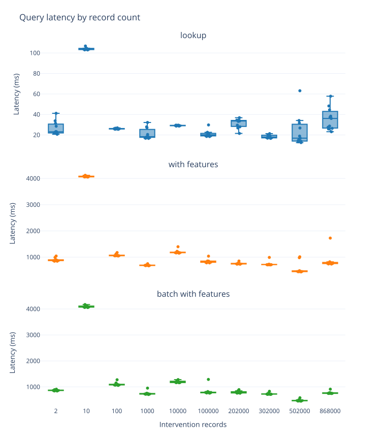
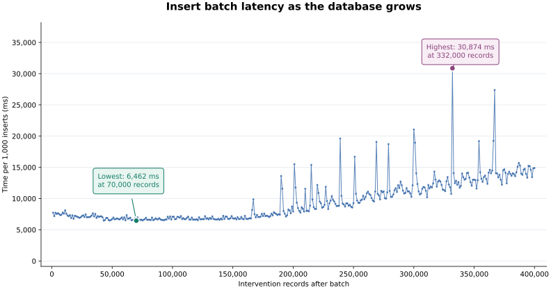

<!-- Draft: confirm author credits, deployment specifications, historical software versions, RLS settings, and current sheet-loading behavior before publication. -->

## TL;DR

We benchmarked an artificial intervention registry: synthetic treatment records with features and links to genes, small molecules, and suppliers. Inserting batches of 1,000 records took roughly 6–7 seconds up to about 150,000 interventions, then became slower as the population grew, reaching 15 seconds at 400 000 interventions. Record lookup times, both with and without features, remained broadly consistent across the tested populations, reaching 868,000 interventions. For this workload, growth affected write performance before lookup performance.

## As experimental registries grow

Experimental registries grow with every screen, sample, and treatment. A registry that starts with a few hundred entries can accumulate hundreds of thousands, each carrying measurements and links to other entities. How does that growth affect the time to retrieve a record, add another batch, or open the registry as a sheet?

Here, we benchmark these operations in LaminDB using a synthetic intervention registry. We find that record lookups show no sustained slowdown through 868,000 interventions, while inserting another 1,000 interventions becomes more expensive as the database fills. Opening the sheet follows a different request path and reaches timeout limits in our manual tests. The measurements help distinguish the cost of retrieving a known record from the costs of population and browsing, with links from the figures to the experiments that produced them.

## An intervention registry

LaminDB [records](https://docs.lamin.ai/lamindb.record) can represent samples, experiments, compounds, and other entities with configurable features and relationships. For this benchmark, each record represents an intervention: a treatment with a dose, protocol, date, duration, supplier, and links to genes and small molecules.

We use 10 suppliers, 100 genes, and 20 small molecules. Each intervention links to one supplier, 3–5 genes, and 1–3 small molecules. We keep these catalogs and link ranges fixed as we increase the intervention population, so the amount of information attached to each new record stays approximately the same.

We then measure three ways of retrieving interventions:

```python
# Retrieve one intervention by its universal identifier.
ln.Record.filter(uid=uid).one_or_none()

# Retrieve the same intervention together with its features.
ln.Record.filter(uid=uid).to_dataframe(include="features")

# Retrieve 20 interventions together with their features.
ln.Record.filter(uid__in=uids).to_dataframe(include="features")
```

These timings include the client work needed to return the result, including database communication and, for feature queries, DataFrame construction. They are not server-only SQL timings.

## Looking up records

Across populations from 1,000 to 868,000 interventions, median UID-only lookup times range from 16 to 33 milliseconds. Retrieving features takes longer, with medians between 0.45 and 1.18 seconds, but shows no consistent increase with population (Figure 1).



*Figure 1 ([source](https://lamin.ai/laminlabs/lamindb-benchmarks/artifact/LUGcWuuXeif0pUPy0003), [data](https://lamin.ai/laminlabs/lamindb-benchmarks/artifact/jJYJR6IQuhmZUMxk0003)): Client elapsed time for retrieving one record by UID, one record with features, and a batch of up to 20 records with features. The distributions include all timed repetitions; medians quoted in the text exclude the first call.*

At the largest completed population, [868,000 interventions](https://lamin.ai/laminlabs/lamindb-benchmarks/run/YGj1nHOZIeOQa8fN), median retrieval times are 32 ms without features, 769 ms with features, and 757 ms for a batch of 20 with features. The feature-bearing batch costs approximately as much as a single-record query. This makes batching useful for this access pattern and suggests that shared costs in feature retrieval deserve closer investigation.

The results vary between runs. In particular, the 10-record run is unusually slow, taking about four seconds for feature retrieval; we retain it in the figure and methods table. The finding is therefore an absence of a sustained size-dependent slowdown, rather than identical latency at every population. The benchmark also repeats queries for fixed sampled identifiers, so it does not measure arbitrary feature filters, sorting, or concurrent clients.

## Adding records

Retrieval is only part of a registry's workload. New interventions must also be saved, together with their features and relationships. We measure this by adding interventions in transactional batches of 1,000 and recording the elapsed time of every batch.

The first 200,000 interventions take a median of 6.93 seconds per batch. This rises to 10.02 seconds between 200,000 and 300,000 interventions, and 13.35 seconds between 300,000 and 400,000 (Figure 2). The median cost of adding another 1,000 interventions is about 1.9 times higher in the final interval than in the first.



*Figure 2 ([source](https://lamin.ai/laminlabs/lamindb-benchmarks/record/EdnmRGzYxAnOzaet), [data](https://lamin.ai/laminlabs/lamindb-benchmarks/artifact/68iEuSlve2I47OS70000)): Client elapsed time per 1,000-intervention insert batch as the population grows to 400,000. The callouts identify the lowest observed batch time, 6.46 seconds at 70,000 records, and the highest, 30.87 seconds at 332,000 records. All 400 batches completed successfully.*

The increasing cost is visible both in the typical batch and in slow outliers:

| Population interval | Median per batch | 95th percentile | Maximum |
| --- | ---: | ---: | ---: |
| 0–200,000 | 6.93 s | 7.82 s | 13.62 s |
| 200,000–300,000 | 10.02 s | 15.57 s | 21.07 s |
| 300,000–400,000 | 13.35 s | 15.88 s | 30.87 s |

These are timings of the full client save path, including row generation, feature saving, transaction completion, and retries. They do not isolate the cost of SQL insertion. The population was built across three successive runs without a reset, so elapsed time and changes in database state may also contribute to the pattern. Establishing the cause requires profiling the Python save path alongside database activity.

## Opening the sheet

A fast UID lookup does not guarantee that opening a large registry in the browser will be equally fast. The web interface exercises a different request path.

In manual tests of the [intervention sheet](https://lamin.ai/laminlabs/lamindb-load-test/record/lQZWbGirzLfcUz6m), opening a population of roughly 200,000 records was responsive. At 300,000, loading took approximately five seconds. At 500,000 and 850,000, the request timed out. The diagnostic captured during the failure pointed to a statement timeout in a recursive query for related records.

These observations were not collected with the repeated timing procedure used for the lookup benchmark. They identify a separate browsing bottleneck on the tested deployment, rather than a general record-count limit. They also show why an assessment of scalability needs to exercise the operations people actually use: retrieving a known record and opening a sheet can encounter different limits.

## Following a result back to its experiment

The figures are outputs of tracked analysis runs in the [benchmark database](https://lamin.ai/laminlabs/lamindb-benchmarks). Their source links let you inspect the measurements behind a result and follow the lineage back to the runs that produced them.

For example, the [insertion analysis](https://lamin.ai/laminlabs/lamindb-benchmarks/record/EdnmRGzYxAnOzaet) loads batch measurements from three population runs and creates a combined table and figure. The table preserves each batch's source run, source artifact, and population before and after insertion. This makes it possible to inspect an individual slow batch or recompute the summary without extracting values from a plotted image.

For teams growing an experimental registry, the practical finding is that lookup, population, and browsing need separate measurements. Here, known-record lookup remains responsive at the largest tested population, while writes become more expensive and sheet loading exposes a separate timeout. Reducing feature-retrieval overhead, understanding the growing write cost, and profiling the sheet-loading query are the next steps suggested by these results.

## Code & data availability

The measurement tables, figures, and tracked runs are available in [laminlabs/lamindb-benchmarks](https://lamin.ai/laminlabs/lamindb-benchmarks). The source code and measurement definitions are in [experiment 2 of the benchmarking repository](https://github.com/laminlabs/lamindb-benchmarks/tree/main/experiments/experiment_002). Click the source links in the figure captions to explore the corresponding results.

## Methods

### Lookup measurements

Population and lookup sampling use separate random generators. Within each run, the same sampled identifiers are reused across repetitions. Most runs contain 11 repetitions: a first call followed by ten subsequent calls. The 10-record run contains ten repetitions. No database cache was deliberately cleared, so the first call should not be interpreted as a cold-cache measurement.

The following medians exclude the first call and are rounded to the nearest millisecond. Each population links to its benchmark run. The batch query returns all available interventions when the population is smaller than 20.

| Interventions | UID lookup (ms) | One with features (ms) | Batch with features (ms) |
| ---: | ---: | ---: | ---: |
| [2](https://lamin.ai/laminlabs/lamindb-benchmarks/run/26WUp49J2FEztC2b) | 23 | 873 | 865 |
| [10](https://lamin.ai/laminlabs/lamindb-benchmarks/run/8PBBlQulpexRDG7D) | 104 | 4,070 | 4,087 |
| [100](https://lamin.ai/laminlabs/lamindb-benchmarks/run/mXhH8pRLSh4mrrHR) | 26 | 1,062 | 1,085 |
| [1,000](https://lamin.ai/laminlabs/lamindb-benchmarks/run/Jt2zGb1uC3IYJzcU) | 18 | 688 | 733 |
| [10,000](https://lamin.ai/laminlabs/lamindb-benchmarks/run/YQPJf3SZvl1YpmNr) | 29 | 1,180 | 1,183 |
| [100,000](https://lamin.ai/laminlabs/lamindb-benchmarks/run/q2CWB8xCmsUMWFG7) | 20 | 820 | 788 |
| [202,000](https://lamin.ai/laminlabs/lamindb-benchmarks/run/kXDAH4OxpnUZcqu3) | 33 | 747 | 776 |
| [302,000](https://lamin.ai/laminlabs/lamindb-benchmarks/run/xshXrgOXn8Yc4D0K) | 18 | 717 | 726 |
| [502,000](https://lamin.ai/laminlabs/lamindb-benchmarks/run/Fv08jrQyfFwIZqtx) | 16 | 452 | 468 |
| [868,000](https://lamin.ai/laminlabs/lamindb-benchmarks/run/YGj1nHOZIeOQa8fN) | 32 | 769 | 757 |

These are populations of interventions, not total physical rows across the record, feature, relationship, and write-event tables. The largest completed lookup run added 2,000 interventions to 866,000 existing interventions; its health measurement records a final population of 868,000. The lookup series includes runs with fresh and previously modified database populations, rather than a uniformly reset sweep.

### Insertion measurements

The insertion series combines [zero to 200,000](https://lamin.ai/laminlabs/lamindb-benchmarks/run/31pnjmYN8DCeOQwT), [200,000 to 300,000](https://lamin.ai/laminlabs/lamindb-benchmarks/run/GOPs3rW021Gb12q0), and [300,000 to 400,000](https://lamin.ai/laminlabs/lamindb-benchmarks/run/IUFOiBQIEfoyTe2D). The corresponding [first](https://lamin.ai/laminlabs/lamindb-benchmarks/artifact/uf0u3SpJYHlcPFVd0000), [second](https://lamin.ai/laminlabs/lamindb-benchmarks/artifact/WLW12JxhwwhFOB9r0000), and [third](https://lamin.ai/laminlabs/lamindb-benchmarks/artifact/1Dw20jtM0mqOrdLZ0000) batch tables contain 200, 100, and 100 successful batches, respectively. The analysis checks that their population coordinates are contiguous and that batch sizes and workload parameters agree.

Each batch is saved in a transaction. Retry waits are included in elapsed time. Catalog and schema setup, serialization of timing diagnostics, and the subsequent statistics refresh are outside the insertion timer. Percentiles describe the observed batch distribution and are not confidence intervals. This series is separate from the lookup series and does not establish performance under concurrent writers.
