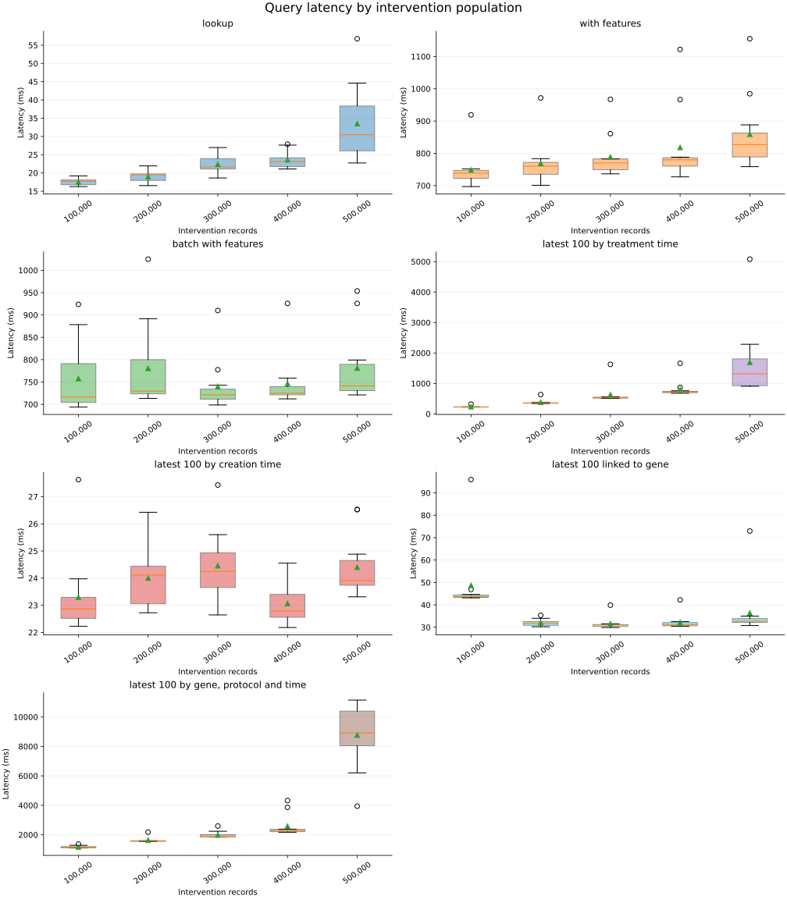
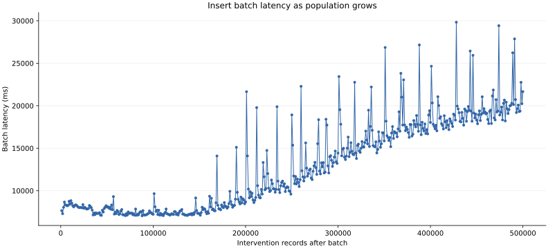
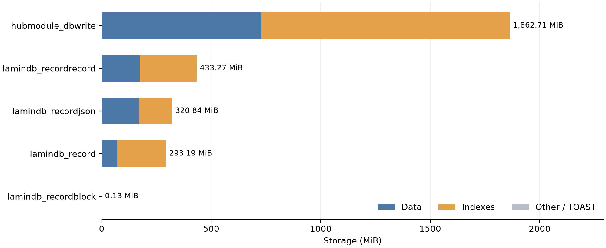

Internal report · 25 October 2026

We want to understand how LaminDB behaves as an instance grows: which reads and writes stay fast, and which become slower as more records and relationships are added. To test this, we set up a synthetic intervention dataset and progressively increase its population while keeping record structure and relationships consistent. Between 100,000 and 500,000 interventions, UID lookups and sorting by creation time remain fast, while sorting by a feature, combined filtering, and batch insertion become slower.

| Operation | What is measured | Median at 100,000 | Median at 500,000 |
| - | - | -: | -: |
| [UID lookup](https://lamin.ai/laminlabs/lamindb-benchmarks/record/xf6h4eu6R1THxcu5) | One intervention by UID, without feature export | 17.7 ms | 30.5 ms |
| [UID lookup with features](https://lamin.ai/laminlabs/lamindb-benchmarks/record/xf6h4eu6R1THxcu5) | One intervention exported with its scalar and linked features | 739 ms | 827 ms |
| [Batch lookup with features](https://lamin.ai/laminlabs/lamindb-benchmarks/record/xf6h4eu6R1THxcu5) | 20 interventions exported with features | 716 ms | 741 ms |
| [Sort by native field](https://lamin.ai/laminlabs/lamindb-benchmarks/record/xf6h4eu6R1THxcu5) | Latest 100 interventions by `created_at` | 22.9 ms | 23.9 ms |
| [Sort by feature](https://lamin.ai/laminlabs/lamindb-benchmarks/record/xf6h4eu6R1THxcu5) | Latest 100 interventions by `treatment_started_at` | 228 ms | 1,317 ms |
| [Latest 100 linked to a gene](https://lamin.ai/laminlabs/lamindb-benchmarks/record/xf6h4eu6R1THxcu5) | Interventions linked to `gene_000`, newest first by `created_at` | 43.7 ms | 32.7 ms |
| [Combined feature query](https://lamin.ai/laminlabs/lamindb-benchmarks/record/xf6h4eu6R1THxcu5) | Gene, protocol and treatment-time filters; latest 100 matches with features | 1.13 s | 8.92 s |
| [Insert 1,000 interventions](https://lamin.ai/laminlabs/lamindb-benchmarks/record/gDSrU33MbIVT5VQB) | One insertion batch, including record generation, validation, saving, and commit | 7.61 s | 19.19 s |

Query values are medians at the stated population. Insertion values are medians per 1,000-intervention batch over the first 100,000 rows (0–100,000) and last 100,000 rows (400,000–500,000), respectively.

[Explore the experiment and all runs](https://lamin.ai/laminlabs/lamindb-benchmarks/record/xZAjWqyrXlHrEwEa) · [Run behind these results](https://lamin.ai/laminlabs/lamindb-benchmarks/record/l3EcwF53KmuUeU50)

## Setup

### Dataset

Each intervention represents a synthetic treatment entry linked to genes, small molecules, and a supplier. It has five scalar features: `dose`, `protocol`, `treatment_date`, `treatment_started_at`, and `treatment_time_min`.

The experiment reproduces database objects and relationships rather than biological content, notes, or large payloads. Gene and small-molecule links are sampled independently.

The measured run uses 100 genes, 20 small molecules, and 10 suppliers. Each intervention links to one supplier, 3–5 genes, and 1–3 small molecules. Catalog sizes and link ranges stay fixed as the intervention population grows.

### Population milestones

The run grows the dataset to 500,000 interventions in batches of 1,000, with set milestones at 100,000, 200,000, 300,000, 400,000, and 500,000. At each milestone, the experiment refreshes PostgreSQL statistics with `ANALYZE` and runs all seven queries 11 times.

Each query reuses the same sampled UID or UID batch across repetitions at a milestone. The batch lookup retrieves 20 interventions. Sorting and filtered queries return up to 100 records.

The experiment runs on [Modal](https://modal.com) in eu-west. The load instance receives the operations being measured, and a separate benchmark instance stores the results.

Query results below are medians across all 11 repetitions unless stated otherwise.

## Query latency results



Latency distributions across all 11 repetitions at each milestone. Orange lines show medians; green triangles show means; circles mark outliers. Each panel has its own latency scale. [Original query latency graph](https://lamin.ai/laminlabs/lamindb-benchmarks/artifact/POla0vvDrA059ZTK).

UID lookups, batch feature exports, and sorting by creation time remain comparatively stable as the population grows. Sorting by the treatment-time feature and combining feature filters with sorting become slower.

In the examples below, `uid` and `uids` are sampled intervention identifiers. The intervention type, target gene, and timestamp feature are resolved before timing:

```python
import lamindb as ln

intervention = ln.Record.get(name="Intervention", is_type=True)
gene_type = ln.Record.get(name="Gene", is_type=True)
gene = ln.Record.filter(type=gene_type, is_type=False, name="gene_000").one()
gene_feature = ln.Feature.get(name="genes", is_type=False)
timestamp_feature = ln.Feature.get(name="treatment_started_at", is_type=False)
```

### UID lookups and feature export

UID lookup medians increase but stay below 40 ms at every milestone. Single-record feature export medians stay below one second. Exporting 20 records with features takes approximately 0.72–0.74 seconds, similar to exporting one record.

**Look up one record**

```python
ln.Record.filter(uid=uid).one_or_none()
```

**Look up one record with features**

```python
ln.Record.filter(uid=uid).to_dataframe(include="features")
```

**Look up 20 records with features**

```python
ln.Record.filter(uid__in=uids).to_dataframe(include="features")
```

At 500,000 interventions, p95 latency is about 51 ms for UID lookup and 1.07 seconds for single-record feature export. Individual calls can therefore exceed the median ranges above. [Query latency analysis](https://lamin.ai/laminlabs/lamindb-benchmarks/record/xf6h4eu6R1THxcu5).

### Sorting by field and feature

Ordering by the native `created_at` field remains stable, with milestone medians below 25 ms. Ordering by the `treatment_started_at` feature rises from about 0.23 seconds to 1.32 seconds. At the final milestone its mean is 1.69 seconds and its p95 is 3.68 seconds.

**Latest 100 by creation timestamp**

```python
list(
    ln.Record.filter(type=intervention, is_type=False)
    .order_by("-created_at", "-uid")[:100]
)
```

**Latest 100 by treatment timestamp**

```python
list(
    ln.Record.filter(type=intervention, is_type=False)
    .order_by(-timestamp_feature, "-uid")[:100]
)
```

The treatment timestamp is stored as a `RecordJson` feature value; `created_at` is a column on `Record`. The queries use different database access paths. [Query latency analysis](https://lamin.ai/laminlabs/lamindb-benchmarks/record/xf6h4eu6R1THxcu5).

### Gene and combined feature filters

The latest-100 gene query has medians of approximately 31–33 ms at 200,000–500,000 interventions. The 100,000-intervention measurement is higher, at about 44 ms. This isolated increase does not persist at larger populations.

```python
list(
    ln.Record.filter(type=intervention, is_type=False)
    .filter(gene_feature == gene)
    .order_by("-created_at", "-uid")[:100]
)
```

The combined query selects interventions linked to `gene_000`, with `protocol_B` and `treatment_started_at` from 1 January 2025 inclusive to 1 July 2025 exclusive. It orders matches by descending treatment time, selects up to 100 UIDs, and then exports their features. Both selection and export are timed together.

```python
from datetime import datetime, timezone

start = datetime(2025, 1, 1, tzinfo=timezone.utc)
end = datetime(2025, 7, 1, tzinfo=timezone.utc)

cohort = (
    ln.Record.filter(type=intervention, is_type=False)
    .filter(
        gene_feature == gene,
        protocol="protocol_B",
        treatment_started_at__gte=start,
        treatment_started_at__lt=end,
    )
    .order_by(-timestamp_feature, "-uid")
)
selected_uids = list(cohort.values_list("uid", flat=True)[:100])
result = (
    ln.Record.filter(uid__in=selected_uids)
    .order_by(-timestamp_feature, "-uid")
    .to_dataframe(include="features")
)
```

Its median grows from 1.13 seconds at 100,000 interventions to 1.58 seconds at 200,000 and 8.92 seconds at 500,000. The final p95 is about 11.1 seconds. This operation has the clearest query-latency growth in the tested sweep. [Source](https://lamin.ai/laminlabs/lamindb-benchmarks/record/xf6h4eu6R1THxcu5).

### Database and non-database time

Across the seven query types and five populations, approximately 74–99.6% of measured time is spent inside driver execute calls, depending on the query and population. The remainder covers work outside those calls, including fetching, Python processing and instrumentation.

The experiment measures Python SDK operations against the database. It does not measure Hub REST endpoints or browser performance. Driver execute time includes network waits and driver overhead as well as database processing. [Timing breakdown analysis](https://lamin.ai/laminlabs/lamindb-benchmarks/record/NGPuYq0wyWPPtN4W).

## Batch insertion latency

The run contains 500 successful insertion batches of 1,000 interventions. Batch latency is initially stable, then increases as the population grows.



Each point is one batch of 1,000 interventions; the horizontal axis shows population after insertion. [Original insertion latency graph](https://lamin.ai/laminlabs/lamindb-benchmarks/artifact/o4qGkDrAxxaKipe6).

| Population interval | Median per 1,000-intervention batch |
| --- | ---: |
| 0–100,000 | 7.61 s |
| 100,000–200,000 | 7.66 s |
| 200,000–300,000 | 11.54 s |
| 300,000–400,000 | 16.71 s |
| 400,000–500,000 | 19.19 s |

The last 20 batches have a median latency of 20.06 seconds. Across the run, individual batches range from 7.05 to 29.83 seconds. [Batch insertion analysis](https://lamin.ai/laminlabs/lamindb-benchmarks/record/gDSrU33MbIVT5VQB).

Batch latency includes generating synthetic rows, constructing the DataFrame, validating and saving records, transaction completion, and any retry waits. Catalog setup, writing timing files, query rounds and `ANALYZE` are outside the batch timer.

The batch timer combines Python processing, database writes, and network time. Separate profiling would be needed to measure the contributions of relationship inserts, index maintenance, and write-event logging.

## Database table distribution

At 500,000 interventions, `pg_database_size` reports 3,105,038,851 bytes: **3.11 GB, or 2.89 GiB**.

The write-event table occupies approximately 63% of the whole database. Index bytes in the four main growing tables alone account for approximately 60% of whole-database size, so indexes occupy more space than the corresponding row data overall.



Data and index storage for the five largest captured tables at 500,000 interventions. The fifth table, `lamindb_recordblock`, occupies only 0.13 MiB. [Database growth analysis graph](https://lamin.ai/laminlabs/lamindb-benchmarks/artifact/mSaEJGP7X5pYFERh).

| Growing table | Rows at 500,000 interventions | Data MiB | Index MiB | Total MiB |
| --- | ---: | ---: | ---: | ---: |
| `hubmodule_dbwrite` | 6,501,894 | 729.9 | 1,132.5 | 1,862.7 |
| `lamindb_recordrecord` | 3,501,741 | 174.3 | 258.9 | 433.3 |
| `lamindb_recordjson` | 2,500,000 | 170.0 | 150.7 | 320.8 |
| `lamindb_record` | 500,134 | 71.0 | 222.1 | 293.2 |

Total relation storage includes overhead beyond the displayed data and main-index sizes.

[Final table distribution](https://lamin.ai/laminlabs/lamindb-benchmarks/artifact/RBCBb8ZjOLpiMjT90000) · [Final health measurement](https://lamin.ai/laminlabs/lamindb-benchmarks/artifact/LnMVZ4kRqMbhnoyd0000) · [Final observation](https://lamin.ai/laminlabs/lamindb-benchmarks/record/sb70V2DUr9IszH6j).

### Physical row growth

The final counts match the expected structure: 2.50 million scalar annotations correspond to five per intervention, and 3.50 million relationship entries correspond to approximately seven per intervention. The `Record` registry contains 500,000 intervention records plus 134 catalog and type records.

Across the captured tables, the health measurement reports 13,003,769 physical rows. Roughly half are application rows and half are write events, consistent with approximately 13 application-table writes and 13 event writes per intervention, plus fixed setup overhead. A count of 500,000 interventions therefore represents a much larger physical database workload. [Final health measurement](https://lamin.ai/laminlabs/lamindb-benchmarks/artifact/LnMVZ4kRqMbhnoyd0000).

`Record`, `RecordRecord`, and `DbWrite` each use more space for indexes than for data. `RecordJson` uses more space for data.

## Sources

- [Query latency analysis](https://lamin.ai/laminlabs/lamindb-benchmarks/record/xf6h4eu6R1THxcu5).

- [Database-call timing breakdown](https://lamin.ai/laminlabs/lamindb-benchmarks/record/NGPuYq0wyWPPtN4W).

- [Batch insertion analysis](https://lamin.ai/laminlabs/lamindb-benchmarks/record/gDSrU33MbIVT5VQB).

- [Source benchmark execution](https://lamin.ai/laminlabs/lamindb-benchmarks/run/Y8o3Xlia9tYUxwLa).

- [Final database observation](https://lamin.ai/laminlabs/lamindb-benchmarks/record/sb70V2DUr9IszH6j).

- [Benchmark source repository](https://github.com/laminlabs/lamindb-benchmarks).
